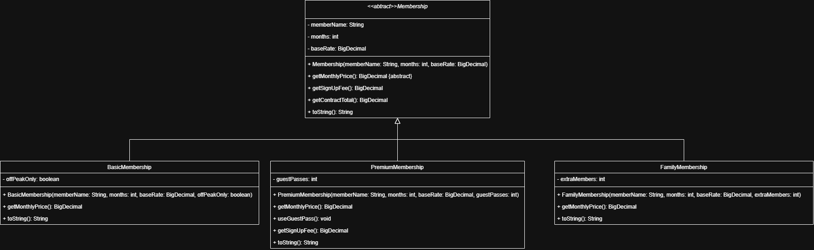
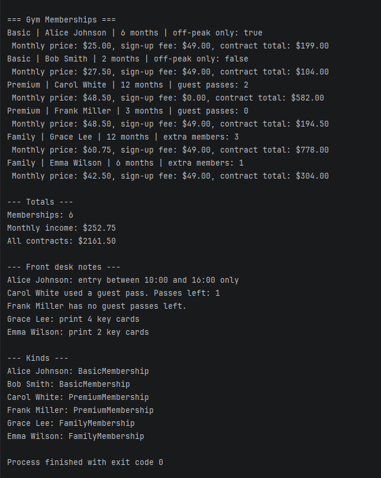

# Gym Memberships

- An application that helps manage different membership types, calculate monthly prices, track contract totals, and display membership information.

## Description of the Project

- The Gym Memberships application is designed to display and calculate different gym memberships. 
  The program includes three membership types: Basic, Premium, and Family, each with its own pricing and benefits.

## Class Diagram



## Features

- Displays three different gym membership types: Basic, Premium, and Family
- Calculates monthly membership prices based on membership type and benefits
- Displays each member's name and actual membership class.

## Setup

### Prerequisites

- Java 17 (Amazon Corretto), the version used in class.
- IntelliJ IDEA Community Edition: <https://www.jetbrains.com/idea/download/>

### Running the application

1. Clone this repository, or download it as a zip and unzip it.
2. In IntelliJ: File > Open, pick the project folder (the one that holds `pom.xml`), press Open.
3. Wait for IntelliJ to finish indexing (progress bar at the bottom).
4. Open `src/main/java/com/pluralsight/YourMainClassName.java`. <!-- replace YourMainClassName with the class that has main -->
5. Right-click inside the file and choose Run 'YourMainClassName.main()'.

## Technologies Used

- Java 17
- IntelliJ IDEA

## Demo



## A piece of code I am proud of

- I'm proud of this code because it uses a for loop to go through each gym membership, display its information, and calculate its monthly price and contract total. 
  I used BigDecimal to calculate the total monthly income and all membership contracts.
- I chose this code because it was the most fun part for me to do throughout the whole project.

```
        System.out.println();
        System.out.println("=== Gym Memberships ===");

        BigDecimal monthlyIncome = BigDecimal.ZERO;
        BigDecimal allContracts = BigDecimal.ZERO;
        for (Membership membership : memberships) {
            System.out.println(membership);
            printCosts(membership);

            monthlyIncome = monthlyIncome.add(membership.getMonthlyPrice());
            allContracts = allContracts.add(membership.getContractTotal());
            
        }
```

## Future Work

- I would add comments throughout the project to explain the code.
- I would do bonus 1 and 2

## Resources

- Java YearUp Fall 2026 hub: <https://raymaroun.github.io/yearup-java-fall2026/>
- Raymond class diagram reference: <https://raymaroun.github.io/yearup-java-fall2026/week-07/reference/class-diagram-reference.html>

## Author

- **Maalik McCutchen**

## Thanks

- Thank you to Raymond for helping with the class diagram I now have an idea on what it should look like for the capstone